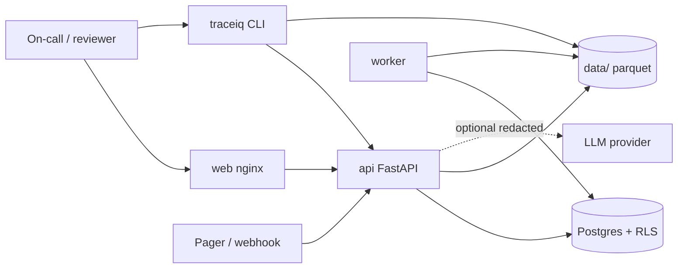
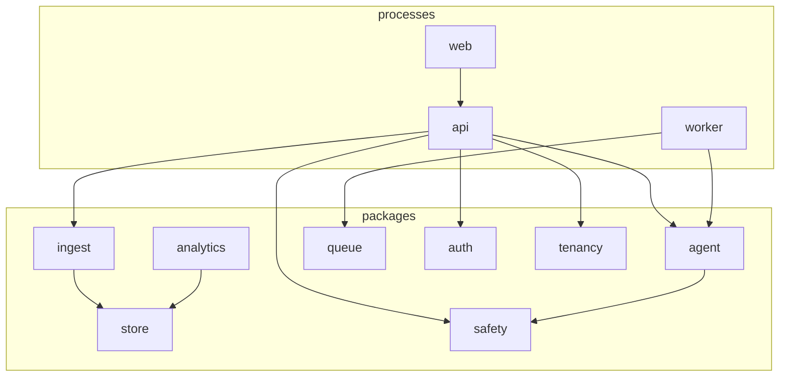
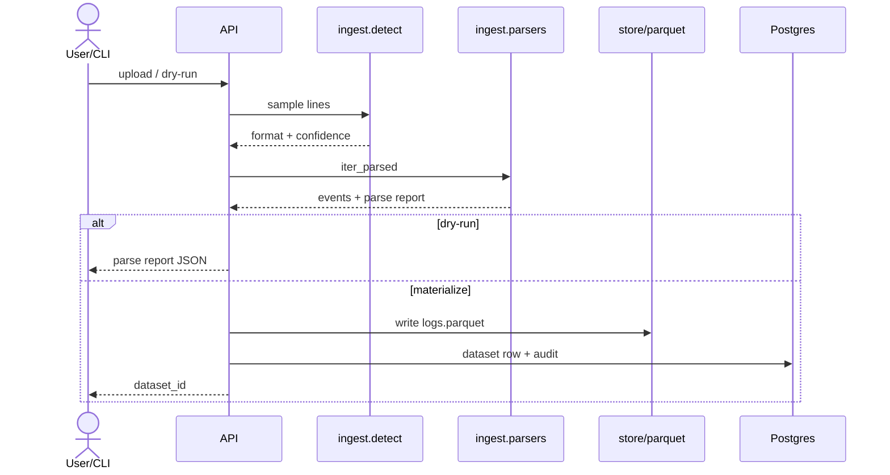
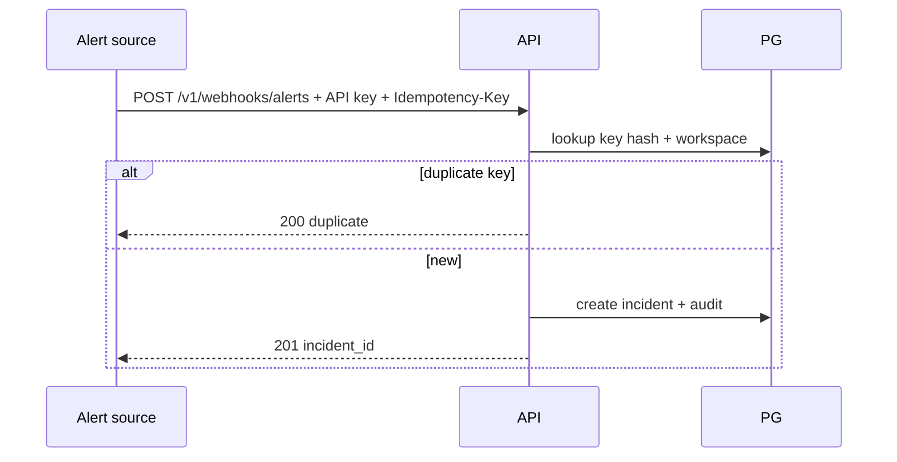

# Architecture

Modular monolith: one Python codebase, three processes (`api`, `worker`, `web` static), plus Postgres. Seams are package boundaries (`ingest`, `store`, `analytics`, `agent`, `safety`, `queue`) so a later split is possible without rewriting the domain.

## Context



```
                 alert webhook / uploads / CLI
                           |
                     +-----+------+
                     |    api     |
                     +--+------+--+
                        |      |
                   +----v--+  +v--------+
                   |postgres|  | parquet |
                   +----+---+  +----+----+
                        |           |
                     +--v-----------v--+
                     |     worker      |
                     +--------+--------+
                              |
                     (optional egress)
```

## Components



## Sequence: ingest



ASCII:

```
CLI/UI -> detect(format) -> parse(lines) -> build_report
                              |
                    dry-run?--+--> return report
                              |
                              +--> parquet + manifest + DB row
```

## Sequence: investigation (crash + resume — intended)

```mermaid
sequenceDiagram
  actor U as Investigator
  participant API
  participant PG
  participant W as Worker
  participant Agent
  U->>API: POST /incidents/{id}/investigations
  API->>PG: insert investigation + job
  API-->>U: investigation_id
  W->>PG: claim job (lease)
  Note over W,Agent: Today the API runs mock sync;<br/>worker handlers are stubs (M10).
  W->>Agent: run_investigation
  Agent-->>W: steps / report
  W->>PG: investigation_steps + report
  Note over W: If worker dies mid-run,<br/>lease expires and another worker claims.
  U->>API: GET .../events (SSE)
  API-->>U: steps (cache / DB)
```

## Sequence: alert webhook



## What happens when X fails

| Failure | Behavior |
| --- | --- |
| Postgres down | `/readyz` fails; writes error; worker idles |
| Worker killed | Lease expires; job reclaimed (when handlers enqueue work) |
| Model timeout | Egress/provider error → degrade / abstain path in runtime |
| Bad upload | Preview returns 400 with readable detail (binary/null bytes) |
| Duplicate webhook | Same Idempotency-Key → `status=duplicate`, no second incident |
